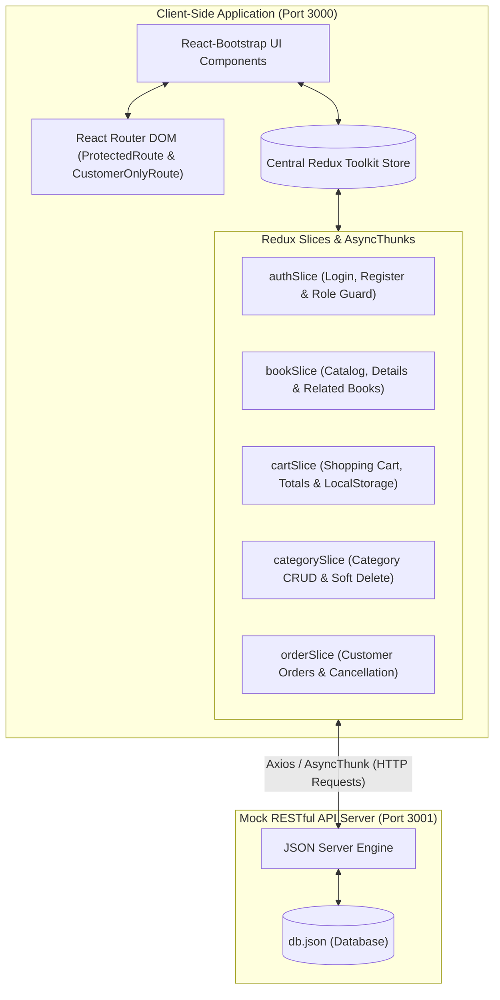

<div align="center">

  # 📚 BookStore Web Application
  ### *A Modern E-Commerce Bookstore & Inventory Management Platform Built with ReactJS*

  [](https://react.dev/)
  [](https://redux-toolkit.js.org/)
  [](https://react-bootstrap.netlify.app/)
  [](https://github.com/typicode/json-server)
  [](LICENSE)

  <p align="center">
    <a href="#-project-overview">Overview</a> •
    <a href="#-architecture--data-flow">Architecture</a> •
    <a href="#-key-features">Features</a> •
    <a href="#-user-guide--screenshots">User Guide</a> •
    <a href="#-mock-api-endpoints">API Docs</a> •
    <a href="#-getting-started">Getting Started</a> •
    <a href="#-team-members--contributions">Contributors</a>
  </p>

</div>

---

## 📌 Project Overview

**BookStore** is a feature-packed Single Page Application (SPA) designed to deliver an intuitive, responsive book shopping experience for readers while empowering store owners with an executive administration portal to manage inventory, categories, orders, and sales analytics.

* **Course:** FER202 — Front-End Web Development with ReactJS
* **Institution:** FPT University Can Tho Campus
* **Class / Term:** SE18 / Fall 2026
* **Development Methodology:** Iterative & Incremental (Agile Framework across 2 Iterations)

---

## 🏛 Architecture & Data Flow

The application implements a centralized immutable state management architecture powered by **Redux Toolkit**, client-side route isolation using **React Router DOM v6**, and communicates with a mock RESTful backend via **JSON Server** and **Axios**:



---

## 🌟 Key Features

### 🛒 1. Customer & Guest Experience (Storefront)
- [x] **Catalog & Discovery:**
  - Responsive book grid with fixed cover aspect ratios (`260px`, `object-fit: cover`) and fallback placeholder handling for broken images.
  - Real-time keyword search by book title and author.
  - Category dropdown filter with instant feedback and reset capabilities.
  - Automatic filtering out of soft-deleted items (`isDeleted: true`).
- [x] **Product Details & Stock Validation:**
  - Comprehensive book synopsis, pricing, and stock status badges (`Còn hàng` / `Hết hàng`).
  - Purchase quantity selector strictly bounded within `[1, stock]` to prevent overselling.
  - Dynamic related-books recommendations (`RelatedBooks`) filtered by matching `categoryId`.
- [x] **Shopping Cart Management:**
  - Automatic quantity accumulation for identical products, capped at current inventory.
  - Inline quantity adjustment directly inside the cart table.
  - Safe item removal guarded by a confirmation modal.
  - Real-time calculation of total quantity and order amount; persistent storage via `localStorage`.
- [x] **Checkout & Order Placement:**
  - Shipping form with client-side validation: receiver name, Vietnamese 10-digit mobile phone normalization (`+84`/`84` $\rightarrow$ `0`), and address.
  - Automatic background stock deduction in `db.json` upon order placement.
  - Dedicated order confirmation view (`OrderSuccessView`).
- [x] **Customer Order Tracking & Cancellation:**
  - Chronological list of customer purchases with status indicators (`Pending`, `Delivered`, `Cancelled`).
  - Customer-initiated order cancellation for pending orders, requiring a valid cancellation reason.

### 🛡️ 2. Admin Management Portal
- [x] **Role-Based Access Control (RBAC):**
  - Session state maintained in Redux Store and synchronized with `localStorage`.
  - `ProtectedRoute`: Guards `/admin/*` routes, redirecting unauthenticated users and blocking unauthorized roles with a custom 403 screen.
  - `CustomerOnlyRoute`: Blocks administrators from shopping and checkout flows.
- [x] **Executive Sales Dashboard:**
  - 4 KPI metric cards: Total Store Revenue (computed exclusively from `Delivered` orders), Total Orders, Books in Stock, and Total Active Categories.
  - Status tabs for fast order filtering (`ALL`, `Pending`, `Delivered`, `Cancelled`).
- [x] **Order Delivery Processing:**
  - Detailed customer shipping and item view (`AdminOrderDetailPage`).
  - Single-click order approval (`Pending` $\rightarrow$ `Delivered`).
  - Order rejection workflow requiring a mandatory justification reason.
- [x] **Book Inventory Management (Full CRUD):**
  - Tabular inventory overview with cover preview, selling price, and stock levels.
  - Unified modal form (`BookFormModal`) supporting both book creation and editing.
  - Automatic sequential book code generation (`b-101`, `b-102`...).
  - **Soft Delete Mechanism:** Books are flagged with `isDeleted: true` to prevent breaking historical order records.
- [x] **Category Management (Full CRUD):**
  - Complete operations: view list, create, edit, and soft delete categories (`CategoryListPage`).
  - Automatic category code generation (`cat-1`, `cat-2`...) and case-insensitive duplicate name prevention.

---

## 📖 User Guide & Demo Credentials

### 🔑 Demo Accounts
Pre-configured user accounts are available in [`db.json`](./db.json) for evaluation:

| Role | Username | Password | Permissions & Available Routes |
| :--- | :---: | :---: | :--- |
| **Administrator** | `admin` | `123` | Full access to `/admin/dashboard`, `/admin/books`, `/admin/categories`, order approval & rejection |
| **Customer** | `customer` | `123` | Browsing catalog, shopping cart, checkout, order placement, personal order history |

---

## 🔌 Mock API Endpoints

The mock RESTful API is served by `json-server` on port `3001` using [`db.json`](./db.json):

| Endpoint | Method | Description | Access Level |
| :--- | :---: | :--- | :---: |
| `/books` | `GET` | Fetch all books (supports query params: `?categoryId=`) | Public |
| `/books/:id` | `GET` | Fetch detailed information of a specific book by ID | Public |
| `/books` | `POST` | Create a new book item in inventory | **Admin** |
| `/books/:id` | `PUT` | Update book information | **Admin** |
| `/books/:id` | `PATCH` | Update book stock or apply Soft Delete (`isDeleted: true`) | Admin / System |
| `/categories` | `GET` | Retrieve list of book categories | Public |
| `/categories` | `POST` | Add a new book category | **Admin** |
| `/categories/:id` | `PATCH` | Update category details or apply Soft Delete | **Admin** |
| `/orders` | `GET` | Retrieve orders (supports filtering by `userId`) | Admin / Customer |
| `/orders/:id` | `GET` | Retrieve full order details by Order ID | Admin / Customer |
| `/orders` | `POST` | Submit a new customer purchase order | Customer |
| `/orders/:id` | `PATCH` | Update order status (`Delivered`, `Cancelled` with reason) | Admin / Customer |
| `/users` | `GET` | Verify user login credentials and roles | Auth / System |
| `/users` | `POST` | Register a new customer account | Public |

---

## ⚡ Getting Started

### 1. Prerequisites
* [Node.js](https://nodejs.org/) (Version **18.x** or higher recommended)
* `npm` (bundled with Node.js)

### 2. Local Setup & Execution

**Step 1: Clone the repository**
```bash
git clone https://github.com/<your-username>/BookStore.git
cd BookStore
```

**Step 2: Install project dependencies**
```bash
npm install
```

**Step 3: Start the Mock REST API Server (Terminal 1)**
```bash
npx json-server --watch db.json --port 3001
```
*API Base URL:* `http://localhost:3001`

**Step 4: Launch the React Client Application (Terminal 2)**
```bash
npm start
```
*Client Application will open at:* `http://localhost:3000`

---

## 📁 Project Structure

```text
BookStore/
├── public/                         # Static assets (favicon, index.html, manifest)
├── src/
│   ├── app/
│   │   └── store.js                # Centralized Redux Store configuration
│   ├── components/                 # Global shared components
│   │   ├── Navbar.jsx              # Navigation header with role-based action controls
│   │   ├── Footer.jsx              # Footer component with site metadata
│   │   └── ProtectedRoute.jsx      # Route guards: ProtectedRoute & CustomerOnlyRoute
│   ├── features/                   # Feature-driven module architecture
│   │   ├── admin/                  # Administrative portal module
│   │   │   ├── AdminDashboardPage.jsx    # KPI metrics dashboard & recent orders
│   │   │   └── AdminOrderDetailPage.jsx  # Order details, approval & rejection
│   │   ├── auth/                   # Authentication module
│   │   │   ├── authSlice.js        # Redux slice managing user session & role
│   │   │   ├── LoginPage.jsx       # User login interface
│   │   │   └── RegisterPage.jsx    # Customer registration with password complexity
│   │   ├── books/                  # Book management module
│   │   │   ├── bookSlice.js        # Redux slice & AsyncThunks for book entity
│   │   │   ├── BookList.jsx        # Public catalog grid with search & category filter
│   │   │   ├── BookCard.jsx        # Book card component with stock badges
│   │   │   ├── BookDetail.jsx      # Book details view with stock-guarded selector
│   │   │   ├── RelatedBooks.jsx    # Related books recommendation component
│   │   │   ├── AdminBookListPage.jsx # Admin book inventory management table
│   │   │   └── BookFormModal.jsx   # Admin Create/Edit book modal with auto-code
│   │   ├── cart/                   # Shopping cart & checkout module
│   │   │   ├── cartSlice.js        # Redux slice for cart actions & real-time total
│   │   │   ├── CartPage.jsx        # Shopping cart view with quantity adjustment
│   │   │   ├── CartItemRow.jsx     # Individual cart item row component
│   │   │   ├── CartSummary.jsx     # Cart summary with subtotal and checkout button
│   │   │   ├── CheckoutPage.jsx    # Shipping form with phone normalization
│   │   │   └── OrderSuccessView.jsx# Order confirmation screen
│   │   ├── categories/             # Category management module
│   │   │   ├── categorySlice.js    # Redux slice for category CRUD operations
│   │   │   ├── CategoryListPage.jsx# Admin category table view
│   │   │   └── CategoryFormModal.jsx # Admin category create/edit modal
│   │   └── orders/                 # Customer order tracking module
│   │       ├── orderSlice.js       # Redux slice for customer orders & cancellation
│   │       └── OrderHistoryPage.jsx# Customer order history with cancellation modal
│   ├── App.css                     # Custom styling overrides
│   ├── App.js                      # Root router configuration (React Router DOM)
│   └── index.js                    # Application entry point (Redux Provider & Bootstrap)
├── db.json                         # Mock database source for JSON Server
├── guidelines.md                   # Team UI conventions and development standards
├── package.json                    # Project metadata, dependencies, and scripts
├── sonar-project.properties        # SonarQube static code analysis configuration
└── README.md                       # Main project documentation
```

---

## 📈 Development Iterations (Backlog Roadmap)

- [x] **Iteration 1 — Core Architecture & Layout:**
  - Project setup, central Redux store integration, and `json-server` mock database configuration.
  - Global navigation layout (`Navbar`, `Footer`) and public catalog (`BookList`, `BookCard`).
  - Product details view (`BookDetail`) and related books recommendation (`RelatedBooks`).
  - Basic shopping cart flow (`cartSlice`, `CartPage`).
  - Authentication flow (`authSlice`, `LoginPage`, `RegisterPage`, `ProtectedRoute`).
  - Initial admin book listing and book creation (`AdminBookListPage`, `BookFormModal`).
- [x] **Iteration 2 — Commerce Flow & Advanced Administration:**
  - Real-time search by title/author and category dropdown filtering (`BookList`).
  - Stock-bounded quantity selector across product details and shopping cart.
  - Shipping address form validation and order placement with automated inventory deduction (`CheckoutPage`).
  - Customer order history tracking and cancellation modal (`OrderHistoryPage`, `orderSlice`).
  - Admin executive sales dashboard with 4 revenue and inventory KPI metrics (`AdminDashboardPage`).
  - Admin order delivery management: detailed inspection, single-click approval, and rejection with mandatory reason (`AdminOrderDetailPage`).
  - Full category CRUD operations with duplicate name prevention and soft delete (`CategoryListPage`, `CategoryFormModal`).
  - Non-destructive soft delete mechanism for books (`AdminBookListPage`).

---

## 👥 Team Members & Contributions

Developed by a 5-member team for the **FER202** course at FPT University:

| No. | Full Name | Student ID | Team Role | Assigned Tasks (Based on Team Backlog) |
| :---: | :--- | :---: | :---: | :--- |
| **1** | **Trần Nguyễn Thanh Hào** | **CE200338** | **Team Leader** | System layout (`Navbar`, `Footer`), Public Book Catalog (`BookList`, `BookCard`), Real-time Search & Category Filtering, Admin Overview & Revenue Dashboard (`AdminDashboardPage`), Manage Order Delivery (`AdminOrderDetailPage`: View, Approve, Reject), Category Update & Soft Delete. |
| **2** | **Trương Anh Tuấn** | **CE200779** | Developer | Product Details module (`BookDetail`), Stock-guarded quantity selector, Related books recommendation (`RelatedBooks`), Customer Order History tracking & Cancel placed order (`OrderHistoryPage`, `orderSlice`). |
| **3** | **Trương Anh Tuấn** | **CE201233** | Developer | Shopping Cart module (`CartPage`, `CartItemRow`, `CartSummary`, `cartSlice`), `localStorage` persistence, Checkout & Order Placement (`CheckoutPage`), Delivery form validation & automatic stock deduction. |
| **4** | **Lương Trung Hiếu** | **CE201492** | Developer | Admin Book Management (`AdminBookListPage`), Book Create/Update Modal form (`BookFormModal`), Sequential book code generation, Non-destructive book soft deletion (`isDeleted: true`). |
| **5** | **Đỗ Trần Thiên Phúc** | **CE201183** | Developer | User Authentication & Session Management (`LoginPage`, `RegisterPage`, `authSlice`), Route Guard protection (`ProtectedRoute`), View Categories List & Create A Category (`CategoryListPage`, `CategoryFormModal`, `categorySlice`). |

---

## 📜 License & Academic Disclaimer

This project is licensed under the **MIT License** — see the [LICENSE](LICENSE) file for details.

> **Academic Disclaimer:** This software is developed solely for educational and grading purposes in the **FER202 (Front-End Web Development with ReactJS)** course at **FPT University Can Tho Campus**. All book metadata and sample images are utilized strictly under fair educational use.

<div align="center">
  <sub>FER202 Group Project — Class SE18 / Fall 2026, FPT University Can Tho Campus.</sub>
</div>
