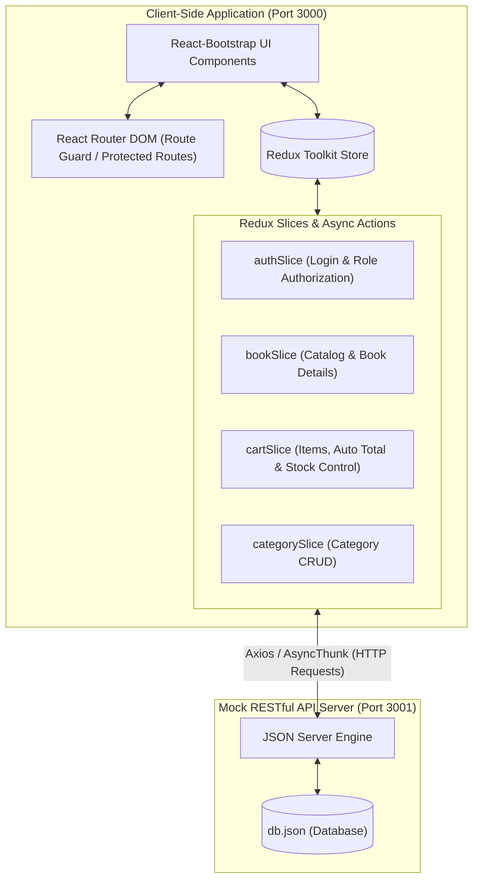

<div align="center">

  # 📚 BookStore Web Application
  ### *A Modern E-Commerce Bookstore Platform Built with ReactJS*

  [](https://react.dev/)
  [](https://redux-toolkit.js.org/)
  [](https://react-bootstrap.netlify.app/)
  [](https://github.com/typicode/json-server)
  [](LICENSE)

  <p align="center">
    <a href="#-project-overview">Overview</a> •
    <a href="#-architecture--data-flow">Architecture</a> •
    <a href="#-key-features">Features</a> •
    <a href="#-mock-api-endpoints">API Docs</a> •
    <a href="#-getting-started">Getting Started</a> •
    <a href="#-team-members--contributions">Contributors</a>
  </p>

</div>

---

## 📌 Project Overview

**BookStore** is an interactive, modern Single Page Application (SPA) designed for online book browsing, purchasing, and store administration. The application delivers an intuitive shopping journey for readers and an integrated management portal for store owners to supervise inventory, product categories, and sales analytics.

* **Course:** FER202 — Front-End Web Development with ReactJS
* **Institution:** FPT University
* **Internal Code Guidelines:** Refer to [FRONTEND_GUIDELINES.md](./FRONTEND_GUIDELINES.md)

---

## 🏛 Architecture & Data Flow

The project follows a centralized state management pattern using **Redux Toolkit**, client-side routing with **React Router v6**, and interacts with a mock RESTful backend via **JSON Server**:



---

## 🌟 Key Features

### 🛒 1. Customer & Guest Experience
- [x] **Catalog & Discovery:**
  - Responsive book grid display with uniform cover aspect ratios, titles, authors, and pricing.
  - Real-time search by book title with instant feedback.
  - Instant category filtering via dropdown selection.
  - Pagination and sorting mechanisms by price.
- [x] **Product Details:**
  - Comprehensive book information (synopsis, real-time stock status, current and original pricing).
  - Purchase quantity selector: minimum limit of 1 and **strict validation against current inventory (`stock`)**. Buttons automatically disable upon reaching boundaries.
  - Related books recommendation: dynamically filters 3–4 items sharing the same `categoryId` (excluding current item).
- [x] **Shopping Cart Management:**
  - Add to cart capability with automatic quantity accumulation for identical products.
  - Real-time quantity adjustment directly in cart table.
  - Remove single items or clear the entire cart.
  - Real-time computation of total quantity and **total order amount** via Redux Selectors.
- [x] **Checkout & Order Placement:**
  - Shipping address form with robust client-side validation (Full Name, 10-digit Phone Number, Delivery Address).
  - Prevention of order submission on empty cart.
  - Order persistence to database (`POST /orders`), automatic cart clearance, and redirection to order confirmation.

### 🛡️ 2. Admin Management Portal
- [x] **Authentication & Role-Based Authorization:**
  - Login system supporting two distinct roles: `admin` and `customer`.
  - Session state maintained in Redux Store and synchronized with LocalStorage.
  - `ProtectedRoute`: Guards `/admin/*` routes, redirecting unauthenticated or unauthorized users back to the Login page.
- [x] **Book Inventory Management (Full CRUD):**
  - Tabular view of all books with cover preview, price, and stock quantities.
  - Shared modal form supporting both book creation (`POST /books`) and updates (`PUT /books/:id`).
  - Form validation: non-empty title, positive price (`price > 0`), non-negative stock (`stock >= 0`), valid category selection.
  - Deletion of books (`DELETE /books/:id`) guarded by a confirmation dialog.
- [x] **Category Management (Full CRUD):**
  - Complete operations: view list, create, edit, and delete categories.
  - **Data Integrity Rule:** Prohibits deletion of any category currently associated with active books in inventory.
- [x] **Admin Sales Dashboard:**
  - Aggregates total store revenue calculated from completed customer orders.
  - Displays total books sold and inventory health overview.

---

## 🔌 Mock API Endpoints

The mock RESTful API is served by `json-server` on port `3001` using [`db.json`](./db.json) as the data source:

| Endpoint | Method | Description | Access Level |
| :--- | :---: | :--- | :---: |
| `/books` | `GET` | Fetch all books (supports query params: `?q=` or `?categoryId=`) | Public |
| `/books/:id` | `GET` | Fetch detailed information of a specific book by ID | Public |
| `/books` | `POST` | Create a new book item in inventory | **Admin** |
| `/books/:id` | `PUT` / `PATCH` | Update book information | **Admin** |
| `/books/:id` | `DELETE` | Delete a book from inventory | **Admin** |
| `/categories` | `GET` | Retrieve list of book categories | Public |
| `/categories` | `POST` | Add a new book category | **Admin** |
| `/categories/:id` | `PUT` / `PATCH` | Update category details | **Admin** |
| `/categories/:id` | `DELETE` | Delete category (with book dependency check) | **Admin** |
| `/orders` | `GET` | Retrieve all customer purchase orders | **Admin** |
| `/orders` | `POST` | Submit a new customer purchase order | Customer |
| `/users` | `GET` | Verify user login credentials and roles | Auth / System |

---

## 🔑 Demo Credentials

Test accounts are pre-configured in [`db.json`](./db.json) for evaluation:

| Role | Username | Password | Access Permissions |
| :--- | :---: | :---: | :--- |
| **Administrator** | `admin` | `123` | Full access to all administrative routes (`/admin/*`) and CRUD actions |
| **Customer** | `customer` | `123` | Browsing, cart management, checkout, and personal order tracking |

---

## ⚡ Getting Started

### 1. Prerequisites
* [Node.js](https://nodejs.org/) (Version **18.x** or higher recommended)
* `npm` (bundled with Node.js) or `yarn`

### 2. Installation & Local Setup

**Step 1: Clone the repository**
```bash
git clone https://github.com/<your-username>/BookStore.git
cd BookStore
```

**Step 2: Install dependencies**
```bash
npm install
```

**Step 3: Start the Mock REST API Server**
> Run `json-server` in **Terminal 1** on port **3001**:
```bash
npx json-server --watch db.json --port 3001
```
*API Base URL:* `http://localhost:3001`

**Step 4: Launch the React Application**
> Open **Terminal 2** and start the development server:
```bash
npm start
```
*Client Application will open at:* `http://localhost:3000`

---

## 📁 Project Structure

```text
BookStore/
├── public/                         # Static assets (favicon, index.html, manifest)
├── src/
│   ├── app/
│   │   └── store.js                # Centralized Redux Store configuration
│   ├── components/                 # Global reusable components
│   │   ├── Navbar.jsx              # Navigation header (Search, Filter, Cart Badge, Auth)
│   │   ├── Footer.jsx              # Footer component with site metadata
│   │   └── ProtectedRoute.jsx      # Route guard for role-based access control
│   ├── features/                   # Feature-driven module architecture
│   │   ├── auth/                   # Authentication module
│   │   │   ├── authSlice.js        # Redux slice managing user session & role
│   │   │   └── LoginPage.jsx       # User login interface
│   │   ├── books/                  # Book management module
│   │   │   ├── bookSlice.js        # Redux slice & AsyncThunks for book entity
│   │   │   ├── BookList.jsx        # Public book catalog grid view
│   │   │   ├── BookDetail.jsx      # Book details page with stock validator
│   │   │   └── BookFormModal.jsx   # Admin Create/Edit book modal
│   │   ├── cart/                   # Shopping cart & checkout module
│   │   │   ├── cartSlice.js        # Redux slice for cart actions & real-time total
│   │   │   ├── CartPage.jsx        # Shopping cart view
│   │   │   └── CheckoutPage.jsx    # Shipping details form & order placement
│   │   └── categories/             # Category management module
│   │       ├── categorySlice.js    # Redux slice for category CRUD operations
│   │       ├── CategoryListPage.jsx# Admin category table view
│   │       └── CategoryFormModal.jsx # Admin category create/edit modal
│   ├── App.css                     # Custom styling overrides
│   ├── App.js                      # Root router configuration (React Router DOM)
│   └── index.js                    # Application entry point (Redux Provider & Bootstrap)
├── db.json                         # Mock database source for JSON Server
├── FRONTEND_GUIDELINES.md          # Team UI conventions and development standards
├── package.json                    # Project metadata, dependencies, and scripts
└── README.md                       # Main project documentation
```

---

## 📈 Product Roadmap

- [x] **Sprint 1 — Core Architecture & Layout (Iteration 1):**
  - Git repository setup and feature-driven directory structure.
  - Redux Toolkit store integration and `json-server` mock database configuration.
  - Global navigation layout (`Navbar`, `Footer`) and public catalog (`BookList`).
  - Authentication flow (`authSlice`, `LoginPage`, `ProtectedRoute`).
- [x] **Sprint 2 — Commerce Flow & Inventory Management (Iteration 2):**
  - Book details page (`BookDetail`) with stock-guarded quantity selector.
  - Shopping cart management (`cartSlice`, `CartPage`) with real-time total computation.
  - Checkout form validation and order placement (`CheckoutPage` $\rightarrow$ `orders`).
  - Full CRUD operations for Books and Categories (`BookFormModal`, `CategoryListPage`).
- [ ] **Sprint 3 — Analytics & UX Polish (Iteration 3):**
  - Administrative sales dashboard and revenue reporting.
  - Enhanced UX: skeleton loading, empty state illustrations, and toast notifications.
  - Comprehensive end-to-end testing and final presentation preparation.

---

## 👥 Team Members & Contributions

Developed by a 5-member team for the **FER202** course at FPT University:

| No. | Full Name | Student ID | Team Role | Core Modules & Assigned Responsibilities |
| :---: | :--- | :---: | :---: | :--- |
| **1** | **Trần Nguyễn Thanh Hào** | **CE200338** | **Team Leader** | Project coordination, core setup, Book Browsing catalog (`BookList`), Title Search, Category Filter, Global Layout (`Navbar`, `Footer`). |
| **2** | **Trương Anh Tuấn** | **CE200779** | Developer | Product Details module (`BookDetail`), Stock-guarded quantity selector, Related books recommendation (`RelatedBooks`). |
| **3** | **Trương Anh Tuấn** | **CE201233** | Developer | Shopping Cart module (`CartPage`, `cartSlice`), Checkout & Order Processing (`CheckoutPage`, `orders`). |
| **4** | **Lương Trung Hiếu** | **CE201492** | Developer | Admin Book Management (`AdminBookList`, `BookFormModal`), Full Book CRUD operations, Form validation. |
| **5** | **Đỗ Trần Thiên Phúc** | **CE201183** | Developer | Admin Category Management (`CategoryListPage`, Full Category CRUD), User Authentication & Route Guard (`authSlice`, `ProtectedRoute`), Revenue Analytics. |

---

## 📜 License & Academic Disclaimer

This project is licensed under the **MIT License** — see the [LICENSE](LICENSE) file for details.

> **Academic Disclaimer:** This software is developed solely for educational and grading purposes in the **FER202 (Front-End Web Development with ReactJS)** course at **FPT University**. All book metadata and sample images are utilized strictly under fair educational use.

<div align="center">
  <sub>FER202 Group Project — Class SE18 / Fall 2026, FPT University Can Tho Campus.</sub>
</div>
